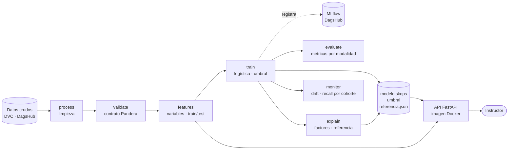

# Arquitectura

El sistema tiene tres partes: un **pipeline** reproducible que va de los datos crudos al
modelo y sus reportes, una **API** que sirve el riesgo a los instructores, y las
**prácticas de calidad** que protegen a ambos (pruebas, CI y revisión por Pull Request).

## El pipeline (`dvc.yaml`)

Cada etapa es un módulo de `src/desercion/` y se ejecuta con
`uv run python -m desercion.<módulo>`. `uv run dvc repro` ejecuta solo las etapas cuyo
código, configuración o datos cambiaron, y guarda en `dvc.lock` el hash de cada entrada
y salida.

| Etapa | Qué hace | Salidas |
|---|---|---|
| `process` | Limpia los datos, excluye traslados y cancelaciones, quita columnas con fuga y separa `sexo` | `data/processed/aprendices.parquet`, `auditoria.parquet` |
| `validate` | Verifica el contrato de datos con Pandera (43 columnas, tipos, valores y rangos) | `reports/validacion.json` |
| `features` | Crea 3 variables derivadas y divide por cohorte: train hasta 2025-T2, test 2025-T3 y 2025-T4 | `data/features/train.parquet`, `test.parquet` |
| `train` | Entrena la regresión logística, elige el umbral con predicciones out-of-fold y registra el run en MLflow | `models/modelo.skops`, `reports/metricas_modelo_base.json` |
| `evaluate` | Métricas en test, globales y por modalidad | `reports/evaluacion.json` |
| `explain` | Importancia de las variables y el aprendiz promedio de train | `reports/importancia_variables.json`, `models/referencia.json` |
| `monitor` | PSI por variable y recall por cohorte con intervalo de confianza | `reports/drift/drift.json`, `drift.html` |

Fuera del pipeline quedan `tune.py` (búsqueda de hiperparámetros de LightGBM con
Optuna) y `comparar_modelos.py` (comparación de los tres modelos en los mismos folds):
se ejecutan a mano y registran sus resultados en MLflow, porque no producen el modelo
que se despliega ([ADR 002](decisiones/0002-eleccion-modelo.md)).

## Dónde vive cada cosa

| Qué | Dónde | Por qué |
|---|---|---|
| Código, configuración, `dvc.lock`, reportes JSON pequeños | Git (GitHub) | Se revisan en cada Pull Request |
| Datos y modelo | DVC, remoto en DagsHub | Son grandes; Git solo guarda su hash en `dvc.lock` |
| Historial de experimentos (parámetros, métricas, commit) | MLflow en DagsHub | Permite comparar y reconstruir cada entrenamiento, incluidos los modelos descartados |
| Entorno (versiones exactas de cada librería) | `pyproject.toml` y `uv.lock` | Todos instalan lo mismo ([ADR 001](decisiones/0001-uso-de-uv.md)) |

En resumen: **DVC dice qué modelo está en producción y MLflow cuenta cómo se llegó a
él.**

## La API

FastAPI con tres endpoints: `/health`, `/aprendices/{id}/riesgo` y
`/cohortes/{id}/riesgo` ([documentación](api.md), [ADR 004](decisiones/0004-api-consulta-y-datos.md)).

- **Al arrancar** carga el modelo, el umbral, la referencia y los aprendices activos, y
  calcula el riesgo de todos con `prediccion.predecir_riesgo`. Luego solo consulta.
- **La lógica de predicción está fuera de la API** (`prediccion.py`,
  `recomendaciones.py`, `explain.py`): la API solo carga y sirve. Así se prueba sin
  levantar un servidor y se podría usar en un proceso por lotes.
- **Docker:** imagen en dos etapas. La primera instala las dependencias con
  `uv sync --frozen --no-dev`; la segunda lleva solo Python, el entorno y los cinco
  archivos que la API lee. Corre con un usuario sin privilegios, tiene un `HEALTHCHECK`
  contra `/health`, y su `.dockerignore` es una lista blanca para que nunca entren
  `.env` ni las credenciales de DVC.

### Cómo llega un modelo nuevo a la API

1. Se cambia el código o los datos y se ejecuta `uv run dvc repro`: se reentrena y
   `dvc.lock` registra el hash del modelo nuevo.
2. El cambio entra por Pull Request; `uv run dvc push` sube el modelo a DagsHub.
3. Quien despliega hace `git pull`, `uv run dvc pull` y reconstruye la imagen.
4. `/health` devuelve `version_modelo`, que debe coincidir con el hash de
   `models/modelo.skops` en `dvc.lock`.

## Calidad

- **Pruebas** (`tests/`, pytest): fuga temporal, contrato de datos, rendimiento mínimo
  del modelo, contrato y errores de la API, que `deserto` nunca salga de la API, que la
  predicción reproduzca las 702 alertas de `evaluate`, el monitoreo, y que los hashes de
  código en `dvc.lock` coincidan con los archivos. Las que necesitan datos reales se
  omiten si no están descargados.
- **Integración continua** (`.github/workflows/ci.yaml`): en cada Pull Request instala
  con `uv sync --locked` y ejecuta Ruff y pytest.
- **Revisión:** `main` está protegida; todo entra por Pull Request con la aprobación del
  otro integrante, la CI en verde y la rama al día con `main`.
- **Reproducibilidad entre sistemas:** `.gitattributes` fuerza saltos de línea LF y los
  archivos que escribe Python usan `newline="\n"`, para que `dvc.lock` tenga los mismos
  hashes en Windows y en Linux.

## Monitoreo

La etapa `monitor` compara cada cohorte nueva con los datos de entrenamiento
([ADR 005](decisiones/0005-monitoreo-sin-evidently.md)):

- **Drift:** PSI por variable. Más de 0.20 es un cambio importante. Las pruebas KS y
  chi-cuadrado se reportan solo como información.
- **Rendimiento:** recall de cada cohorte con intervalo de confianza por bootstrap. Si
  queda por debajo de 0.70, el reporte la marca como «revisar», sin detener el pipeline.

En las cohortes de prueba ninguna variable tiene drift (PSI máximo 0.02); 2025-T4 queda
en «ok» (recall 0.703) y 2025-T3 en «revisar» (0.668, con un intervalo de 0.61 a 0.73
que incluye el objetivo).
